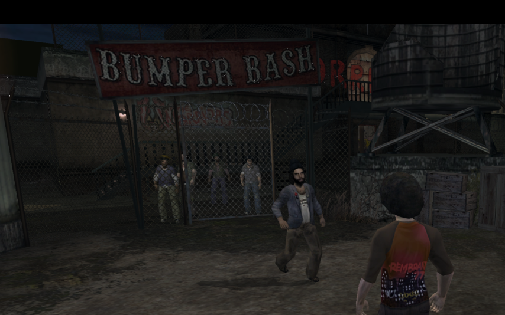

# The Warriors - XBERecomp

An unofficial native PC port of the original Xbox version of The Warriors via static recompilation, built into a 64 bit Windows executable. The game's x86 code is translated to C++ ahead of time, the Xbox kernel, Direct3D and DirectSound calls are implemented on Windows, and everything is drawn with Direct3D 12 and played through XAudio2. Made with the [Xbox XBE Recomp](https://github.com/TGP482/XboxXBERecomp) tool.

> [!NOTE]
> This project does not include any game assets. You must provide the files from your own legally acquired copy of the game to build or play.

> [!WARNING]
> Early work in progress. The game boots and renders in game, but it has not been played through, and there are no releases yet.

## Status

### First working boot



The game recompiles, boots through its XDK initialisation and renders gameplay with the native Direct3D 12 renderer, with no crashes in the first 90 seconds.

### Video

[](https://youtu.be/NpzpBngV25E)

### Done
- Recompiled from the NTSC retail XBE (XDK 5849, sha1 `fe246a74501cd10d2ce89ca5dbda5080d2b2edcc`).
- XDK symbols the signature scan could not resolve on a retail disc, found by hand and documented in `config/game.toml`.
- DirectSound exports the SDK has no version of (pitch, LFO, cones, 3D voice data, sound streams made through `IDirectSound`), handled in `src/game/dsound.cpp`.
- The MCPX APU sample counter that XACT reads directly, kept running in `src/common/apu_clock.cpp`.
- XACT streamed cues (cutscene dialogue and music) wait until they are started and stay stopped once stopped, so skipped cutscenes no longer keep playing their audio.
- `D3DDevice_DrawIndexedVerticesUP`, which the SDK has no version of, drawn through the host's `DrawVerticesUP` (`src/game/d3d.cpp`).
- Sound pitch and pitch variation, carried over to the host mixer's frequency.
- XACT's 3D sounds (punches, footsteps, voices, ambience) play through their submix's speaker bins at its distance and cone volume; the host mixes no voice into another, so they had only reached the reverb send (`src/game/xact_routing.cpp`).
- The Rockstar logo can be skipped like the other boot movies (`src/game/movies.cpp`).
- Keyboard and mouse for player 1, alongside a controller on the same port (`src/game/kbm.cpp`). The mouse turns the camera itself by its own angle, as on PC, through the camera's yaw and pitch speeds (`src/game/camera.cpp`), and stands in for the right stick where the camera does not read it (the gang command menu). In menus the left button selects, the right button backs out and the wheel scrolls.
- A settings panel on F10 (`src/game/menu.cpp`): mouse sensitivity, invert and smoothing, every key binding, the controller's camera speed, invert, dead zone, vibration and button layout, and the display mode, resolution, frame rate cap, VSync, render scale and anisotropic filtering.

### Default keys
| Action | Keys |
|---|---|
| Move, walk | W A S D, Left Alt |
| Camera | Mouse |
| Light attack (X) | Left mouse |
| Heavy attack, charge (A) | Right mouse, Enter |
| Grab, throw (B) | E, Backspace |
| Action: jump, climb, mug (Y) | Space |
| Sprint (LT) | Left Shift |
| Target, reverse a grapple (RT) | Q |
| Block (Black) | F |
| White | R |
| Rage (both triggers) | Z |
| Gang commands (left stick click) | C |
| Right stick click | Middle mouse, V |
| D-pad | Arrow keys, 1 2 3 4 |
| Pause (Start), Back | Escape, Tab |
| Settings panel | F10 |

### Known issues
- 3D sounds are attenuated by distance but not panned: the HRTF positioning, Doppler, LFO and I3DL2 reverb are not reproduced.
- `IDirectSoundBuffer_PlayEx` and `PauseEx` start and pause at once, without their time stamps.
- The game's Bink version differs from the one the SDK knows, so Bink movies do not get the SDK's frame rate fix.
- The game runs at 30 FPS, its own frame pacing; nothing unlocks it yet. The camera follows the mouse at that rate too.
- The game's button prompts still show the controller's buttons.
- Only the opening missions have been played so far.

## Building

### 1. Clone the Repository
Clone this repository with its SDK submodule using [Git](https://git-scm.com/):
```
git clone --recursive https://github.com/Antriksh1984/TheWarriors-XBERecomp.git
```

### 2. Add the Required Game Files
Place your extracted game data files in the `assets` folder. `default.xbe` must be there, with the game's folders (`audio`, `bik` and the `.wad` files) beside it.

### 3. Install Dependencies
Install Visual Studio 2022 (or its Build Tools) with **Desktop development with C++**, **C++ Clang tools for Windows** and **C++ CMake tools for Windows** (`build.bat` offers to add the last two).

### 4. Build the Project
Run `build.bat`. The first build recompiles the game and takes a while. The exe is written to `out\build\release`.

## System Requirements
- Windows 10 64-bit
- A GPU with support for Direct3D 12

## Credits

- [Xbox XBE Recomp](https://github.com/TGP482/XboxXBERecomp) by TGP482, the recompiler and runtime this is built on, and [SCDA-XBERecomp](https://github.com/TGP482/SCDA-XBERecomp), which this project follows.
- [XenonRecomp](https://github.com/hedge-dev/XenonRecomp) for the overridable function layout and instruction hooks.
- [Zydis](https://github.com/zyantific/zydis) for decoding x86 instructions, [toml++](https://github.com/marzer/tomlplusplus) for the configs, [Dear ImGui](https://github.com/ocornut/imgui) for the settings overlay and [SDL](https://github.com/libsdl-org/SDL) for the window, input and controllers.
